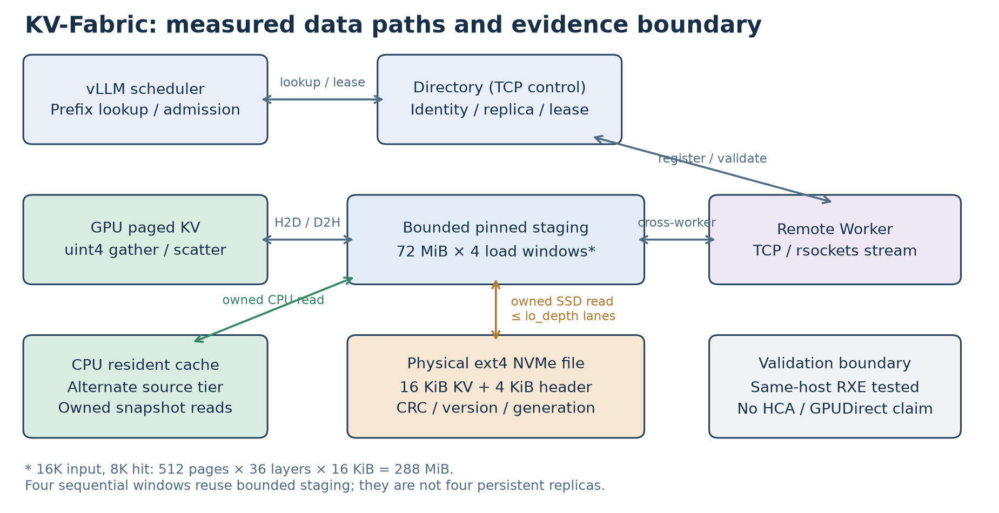
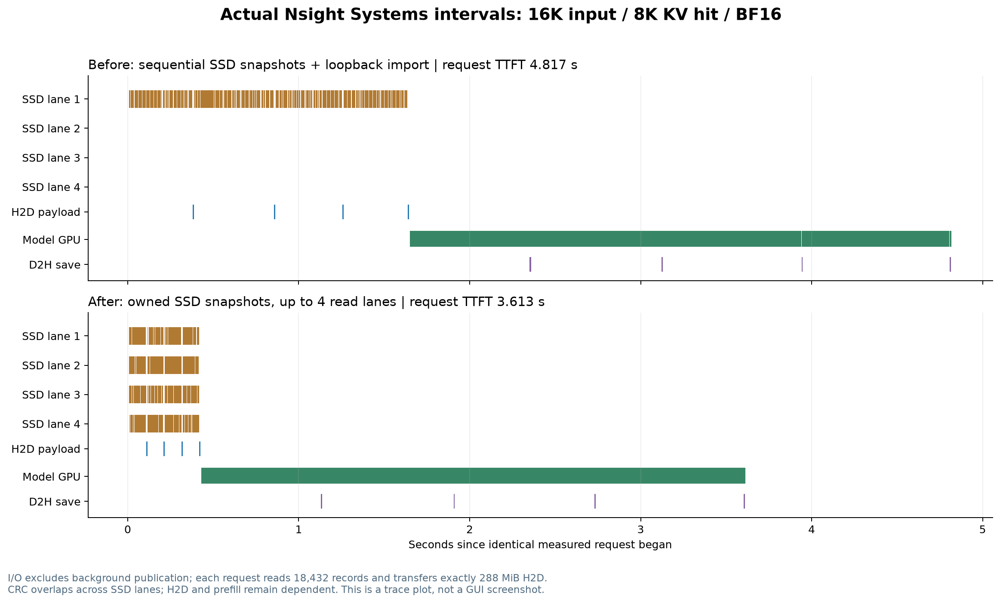
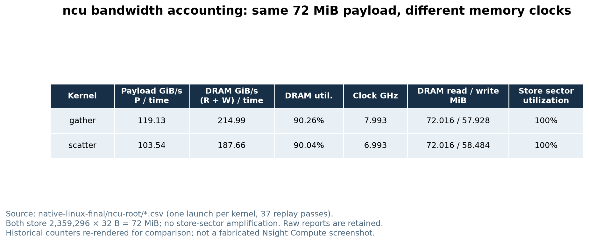

# KV-Fabric

KV-Fabric 是一套 C11 分布式 KV Cache。目录服务维护 KV 前缀、副本和租约。Worker 默认通过 TCP 直接传输 Tensor，也可使用 RDMA rsockets 数据面，再由 CPU 或 NVIDIA CUDA 导入本地分层缓存。

| 路径 | 职责 |
| --- | --- |
| [src/control](src/control/) | Wire V3、全局目录、心跳、租约与 C SDK |
| [src/worker](src/worker/) | 设备传输、Segment 池、连接池、前缀索引和分层存储 |
| [src/nanovllm](src/nanovllm/) | Nano-VLLM 推理调度、本地和跨 Worker 前缀复用 |
| [include](include/) | `kvfabric` 与 `miniinfer` 的 C API |
| [tests](tests/) | 控制面、Worker 和通用 KVStore 回归 |

完整项目入口：[交付与复现指南](docs/PROJECT-DELIVERY.md) · [验证报告](docs/KV-FABRIC-VALIDATION-REPORT.md) · [脱敏简历](docs/resume_ai_infra.public.md)

## 性能口径与可复核证据

| 场景 | 实测结果 | 范围 |
| --- | --- | --- |
| Qwen2.5-3B BF16，16K 输入 / 8K SSD 命中 | TTFT P50 **4.961 → 3.675 s** | owned SSD 直读与四 lane 并发，load/save error 为 0 |
| 72 MiB Gather / Scatter kernel | 单向有效 **119.13 / 103.54 GiB/s** | 物理 DRAM 总带宽为 214.99 / 187.66 GiB/s，实际显存时钟约 8 / 7 GHz |
| 16 MiB CUDA KV 跨 Worker 恢复 | **30.195 ms，0.517 GiB/s** | 同机 RXE Soft-RoCE、MTU 9000；含目录/建连/CRC/提交，不代表物理 HCA 或 GPUDirect |

RDMA 是独立的跨 Worker 数据面；本机 RXE 仍慢于同负载 TCP，不将本机 CPU/NVMe 的 Qwen TTFT 收益归给 RDMA。完整归因、失败历史、原始报告和命令见[性能审计](docs/PERFORMANCE-ATTRIBUTION-AUDIT.md)。[三张 README 图片与导出路径](docs/README-VISUALS.md)覆盖分层架构、真实 nsys 时间线和 ncu 带宽账目。

## 构建与测试

在 Linux 或 WSL 上安装 C11 编译器、CMake 3.18+ 和 OpenSSL 开发包。从仓库根目录一次构建目录服务、CPU Worker 和相关工具。

```sh
git clone https://github.com/sahal-colder/kv-fabric.git
cd kv-fabric
cmake -S . -B build-release -DCMAKE_BUILD_TYPE=Release
cmake --build build-release -j
ctest --test-dir build-release --output-on-failure
cmake --install build-release --prefix "$PWD/build-release/install"
```

运行 `build-release/bin/kvfabricd --config config/kvfabric.conf` 启动目录服务。默认监听 `127.0.0.1:9000`。同机和两台 Linux 机器上的 Worker 运行命令见部署文档。

| 可选构建开关 | 用途 |
| --- | --- |
| `-DMINIINFER_WITH_RDMA=AUTO` | 默认探测 rsockets 头文件和库。`ON` 同样探测，`OFF` 构建纯 TCP Worker |
| `-DMINIINFER_WITH_CUDA=ON` | 启用 Worker 的 CUDA C Runtime 搬运，需要 CUDA Toolkit |
| `-DNANO_WITH_CUDA=ON` | 启用 Nano-VLLM 的 CUDA 前向、CUDA Graph 和 KV 页复制 |
| `-DMINIINFER_WITH_URING=ON` | 启用 io_uring 文件后端，需要 liburing 开发包 |
| `-DKVF_SANITIZE=ON` | 启用 ASan 和 UBSan，Linux 可同时检查泄漏 |
| `-DMINIINFER_WITH_KVFABRIC=OFF` | 构建单机存储或推理组件 |

## 数据路径与性能归因图







图片由代码与真实 profiler 区间/计数生成。完整报告本地保留；[公开逐请求测量、计数与导出边界](docs/benchmarks/perf-attribution-2026-11-26/README.md)可复核收益和单位。

## Nano-VLLM 远程 KV

`nanovllm` 和 `miniinfer` 默认只用本地前缀缓存。在同时构建 KV-Fabric 与 MiniInfer Storage 时，可用 `--remote-kv` 加入目录。使用 `--stdin` 可在每次生成结束后保持 Worker 在线，继续接收提示词并服务已发布的完整页。

在第一个终端启动目录。

```sh
build-release/bin/kvfabricd --listen 127.0.0.1:9000
```

在第二个终端启动 Worker A，输入 `The quick brown fox`，等待 `remote_published_pages` 指标输出，并保持该终端打开。`MODEL` 和 `TOKENIZER` 分别替换为权重和词表路径。

```sh
build-release/bin/nanovllm MODEL -z TOKENIZER --stdin -n 8 -t 0 \
  --remote-kv --kv-control-endpoint 127.0.0.1:9000 --kv-tenant demo --kv-page-size 4
```

在第三个终端运行 Worker B。`remote_prefill_skipped_tokens` 给出实际跳过的 Token 数。

```sh
build-release/bin/nanovllm MODEL -z TOKENIZER -i 'The quick brown fox jumps' -n 8 -t 0 \
  --remote-kv --kv-control-endpoint 127.0.0.1:9000 --kv-tenant demo --kv-page-size 4
```

构建时检测到 Python 3 即会登记推理端到端测试。`ctest --test-dir build-release -R nano_remote_inference --output-on-failure` 会启动独立目录、发布者与消费者，校验生成结果、完整 K/V 页摘要和实际 Prefill 计数。

在具备 IB/RoCE 和可用 IPv4 路由的 Linux 主机上，给发布者和消费者加上 `--kv-transport rdma`，并将 `--kv-listen-endpoint` 指向 RDMA 接口的 IPv4 地址。`miniinfer_worker serve|pull` 在位置参数之后接受同样的传输选项。默认启用 `--kv-rdma-fallback`，无可用设备时会告警并切到 TCP。使用 `--no-kv-rdma-fallback` 验证纯 RDMA，使用 `--trace` 查看 `active_transport`。

## 文档

- [CUDA、io_uring 和双机演示](docs/kvfabric-data-plane.md)
- [从 0 阅读代码指南](docs/READING-GUIDE.md)
- [实现与实测报告](docs/KV-FABRIC-IMPLEMENTATION-REPORT.md)
- [通用 KVStore 的 Make 构建与测试](docs/kvstore.md)
- [MiniInfer 存储库与推理 CLI](docs/miniinfer.md)
- [Nano-VLLM 远程 KV 集成与验收](docs/NANOVLLM-REMOTE-KV-INTEGRATION.md)
- [rsockets 数据面、回退策略与验证记录](docs/KV-FABRIC-RDMA-INTEGRATION.md)

- [全仓审计修复账本](docs/KV-FABRIC-AUDIT-REMEDIATION.md)
- [构建、Sanitizer、故障与性能验收](docs/KV-FABRIC-VALIDATION-REPORT.md)
