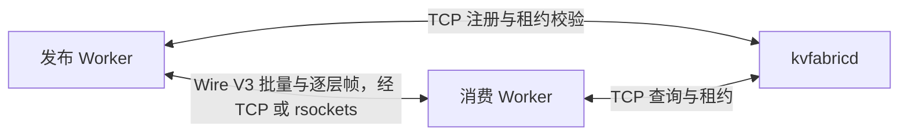

# KV-Fabric Worker rsockets 数据面

## 构建与启动

```sh
cmake -S . -B build-rdma -DCMAKE_BUILD_TYPE=Release -DMINIINFER_WITH_RDMA=ON
cmake --build build-rdma -j
ctest --test-dir build-rdma --output-on-failure
```

CMake 的默认值是 `MINIINFER_WITH_RDMA=AUTO`。`AUTO` 和 `ON` 都检查 `<rdma/rsocket.h>` 并试链接 `librdmacm`、`libibverbs`。成功时 `miniinfer_remote` 使用 `KVF_HAS_RSOCKETS=1`，缺少依赖或选择 `OFF` 时使用 `0`，照常构建 TCP。Debian 和 Ubuntu 的开发包为 `librdmacm-dev`、`libibverbs-dev`。

`nanovllm`、`miniinfer` 和 `miniinfer_worker` 默认使用 TCP。选择 `--kv-transport rdma` 后，用 RDMA 接口上可达的 IPv4 地址绑定并发布 Worker 端点。启用回退时，IB/RoCE RDMA CM 与 TCP 使用各自的端口空间，两个监听器共享目录中登记的 IPv4 地址与数字端口。`--no-kv-rdma-fallback` 只启动 rsockets 监听，初始化失败时以非零状态退出。[Linux RDMA CM 端口空间](https://github.com/torvalds/linux/blob/v6.18/drivers/infiniband/core/cma.c)

先启动目录服务，然后分别在发布者和消费者上运行以下命令。发布者输入 `The quick brown fox` 并保持进程运行。`DIR_IP`、`PUBLISHER_IP` 和 `CONSUMER_IP` 分别取可达的目录地址与两端 RDMA 地址。

```sh
build-rdma/bin/kvfabricd --listen "$DIR_IP:9000"

build-rdma/bin/nanovllm "$MODEL" -z "$TOKENIZER" --stdin -n 8 -t 0 \
  --remote-kv --kv-control-endpoint "$DIR_IP:9000" --kv-page-size 4 \
  --kv-listen-endpoint "$PUBLISHER_IP:0" --kv-tenant rdma-demo \
  --kv-transport rdma --no-kv-rdma-fallback --trace

build-rdma/bin/nanovllm "$MODEL" -z "$TOKENIZER" -i 'The quick brown fox jumps' -n 8 -t 0 \
  --remote-kv --kv-control-endpoint "$DIR_IP:9000" --kv-page-size 4 \
  --kv-listen-endpoint "$CONSUMER_IP:0" --kv-tenant rdma-demo \
  --kv-transport rdma --no-kv-rdma-fallback --trace
```

Worker 文件传输 CLI 同样接受选项，例如 `miniinfer_worker pull NAME CONTROL LISTEN cpu NAMESPACE TOKENS TENSORS --kv-transport rdma --kv-rdma-fallback`。`active_transport` 显示最近一次成功完成的数据面接收所用后端，在首次成功接收前显示启动时选定的后端。Nano-VLLM 在远程统计中打印 `active_transport=TCP` 或 `active_transport=RDMA_RSOCKET`，并在 `--trace` 下单列 `active_transport: ...`。结合 `remote_prefill_skipped_tokens` 和 `remote_import_bytes` 确认该请求确实导入了远程页。

## 接线与描述符生命周期



- `worker.c` 由固定数量的入站线程共同服务监听器。`remote_sock.c` 将 RDMA 监听和连接接到 `rsocket`、`rbind`、`rlisten`、`raccept` 和 `rconnect`，使用 `rfcntl` 设置非阻塞。连接池以 IPv4、端口、发布 Worker Boot UUID 和传输模式匹配连接。每个描述符随附 `kvf_transport`，关闭时分别走 `rclose` 或 `close`。包含 rsocket 描述符的监听、健康检查和 I/O 就绪检查都走 `rpoll`。
- `transfer.c` 通过直接分支调用 `rsend`/`rrecv` 或 `send`/`recv`。短读写、`EINTR` 和 `EAGAIN` 继续使用同一个单调时钟 deadline。两条路径共享 Wire V3 的 36 字节帧头编码与校验，使用原有 `FETCH_BATCH` 数据布局、帧 CRC32C、Manifest 逐层 CRC32C 和租约提交规则。
- `rdma-core 39.0` 的带超时 `rpoll` 在本机复现了连续调用挂起。代码使用零超时 `rpoll`，入站空闲探测间隔为 1 ms，连接和收发等待以 50 µs 为休眠间隔并检查应用 deadline。`rclose` 的连接拆除由 `librdmacm` 执行。[上游 `rpoll` 超时修复](https://github.com/linux-rdma/rdma-core/commit/8f8afbb)
- 默认启用 TCP 回退，可以用 `--kv-rdma-fallback` 显式设置。编译支持缺失、设备枚举失败或 RDMA 监听初始化失败时打印原因，并保留 TCP Worker。某个对端的 RDMA 建连失败时，在原请求剩余预算内尝试 TCP。池内旧连接若已断开会被丢弃，尚未接收批量响应体的读请求可在同一租约和 deadline 内重连。消费端丢弃失败的暂存页，Nano-VLLM 对未验证的后缀执行本地 Prefill。

应用层使用 rsockets 的双边字节流。发布方从现有暂存区调用 `rsend`，消费方用 `rrecv` 读入暂存区，再校验和提交 KV 页。CUDA 仍通过已有的主机暂存与 H2D/D2H 路径搬运。原生 `ibverbs` 单边 `RDMA_WRITE` 直写应用或设备缓冲区需要另外管理内存注册、远端地址、rkey 和完成语义。[rdma-core rsocket 手册](https://github.com/linux-rdma/rdma-core/blob/v39.0/librdmacm/man/rsocket.7.in)

## 原厂 WSL2 内核上的构建与回退验证

2026-11-24 在 Ubuntu 22.04.5 WSL2 验证，内核为 `6.18.54.1-microsoft-standard-WSL2`。CMake 3.22.1，GCC 11.4.0 和 Clang 14.0.0，`librdmacm-dev`/`libibverbs-dev` 版本为 `39.0-1`。CUDA 组使用真实 NVIDIA GeForce RTX 5060 Ti、驱动 610.88 和 CUDA Toolkit 12.8.93。网络实测为同一 WSL2 实例中独立进程的 IPv4 TCP。

```text
$ ibv_devices
Failed to get IB devices list: Function not implemented
$ ibv_devinfo
Failed to get IB devices list: Function not implemented
$ rdma link
Failed to open NETLINK_RDMA socket
$ zgrep CONFIG_INFINIBAND /proc/config.gz
# CONFIG_INFINIBAND is not set
```

原厂内核上 `/sys/class/infiniband` 和 `/dev/infiniband` 均不存在。独立 C11 探针调用 `rsocket(AF_INET, SOCK_STREAM, 0)` 返回 `No such device`。

| 构建 | CTest 通过 | 实际覆盖 |
| --- | ---: | --- |
| CPU Release，默认 `AUTO` | 14/14 | 探测到 rsockets，默认用 TCP 执行协议、存储、Worker 和推理回归 |
| CPU Release，`ON` | 14/14 | C11 编译并链接 rsockets，执行真实 `rpoll` 就绪和重复超时回归 |
| CPU Release，`OFF` | 15/15 | 纯 TCP，额外检查 `rdma` 选项的告警回退和严格失败 |
| CPU Release，`ON` 且屏蔽 RDMA 开发依赖 | 15/15 | 自动生成 `KVF_HAS_RSOCKETS=0`，回退与严格失败同样通过 |
| CPU Debug，`ON`，ASan/UBSan/LSan | 14/14 | 默认 TCP 全套回归通过，另跑生产 CLI 无设备回退与严格失败 |
| CUDA Release，`ON` | 17/17 | 使用真实 GPU 验证 TCP 传输、导入和推理，另跑 CUDA CLI 回退与严格失败 |
| CPU Release，关闭 KV-Fabric | 7/7 | 本地存储回归 |

`readelf` 确认带 rsockets 的 `miniinfer_worker` 链接两个 RDMA 库。`kvfabricd` 与纯 TCP `miniinfer_worker` 的动态依赖中没有这两个库。独立 `make test_unit test_allocator` 也通过。

显式请求 `rdma` 的发布者和消费者运行 `stories15M.bin`。CPU 和 CUDA 两组均打印告警并经 TCP 导入 20 Token（276,480 字节）和 120 Token（1,658,880 字节）的完整 KV 页。每组生成的 8 个 Token ID 与该设备的 `--no-cache` 对照逐字节一致。TCP 对照还核对了全部提示页的 SHA-256，两个用例分别发起了 1 和 4 次批量数据请求。

TCP 故障回归覆盖部分响应后断开、慢响应、CRC 不符、租约失效、重启换 Boot UUID 与取消后的 Prefill。无设备专项覆盖带库和无库二进制的回退、严格启动失败，以及 `MINIINFER_WORKER_PEERS=0` 的短连接模式。测试用普通管道触发真实 `rpoll` 的空闲与就绪路径。

## 定制 WSL2 内核上的 Soft-RoCE 验证

2026-11-24 重启后，WSL2 运行 `6.18.54.1-microsoft-standard-WSL2-rdma`，`CONFIG_INFINIBAND`、`CONFIG_INFINIBAND_USER_ACCESS`、`CONFIG_INFINIBAND_ADDR_TRANS` 和 `CONFIG_RDMA_RXE` 均为 `y`。`rxe0` 绑定 `eth0`，`rdma link` 显示 `ACTIVE / LINK_UP`，`ibv_devinfo` 显示 `PORT_ACTIVE`、链路层 `Ethernet`、GID 类型 `RoCE v2`。发布者和消费者是同一 WSL2 实例内的独立进程，数据端点使用 `198.18.0.1` 的本机路由，目录使用 `127.0.0.1` TCP。数据经过 Linux RXE 软件实现，物理 RoCE/IB 网卡、跨机链路和 GPUDirect 的性能仍待独立测量。[环境记录](benchmarks/rdma/environment.txt) · [ibv_devinfo 原始输出](benchmarks/rdma/ibv_devinfo.txt) · [rdma-core RXE 文档](https://github.com/linux-rdma/rdma-core/blob/v39.0/Documentation/rxe.md)

在新内核上重建的 CPU 和 CUDA Release 分别通过 14/14 和 17/17 项 CTest。使用正式 `miniinfer` 和 `stories15M.bin`，在 CPU 和 RTX 5060 Ti 上分别将严格 RDMA 与 TCP、`--no-cache` 对照。两个前缀长度均打印 `active_transport: RDMA_RSOCKET`，生成的 8 个 Token ID 与各自 TCP 和冷启动逐字节一致。[生产 CLI 核验](benchmarks/rdma/strict-cli.txt)

| 远程复用 Token | KV 页 | 字节 | 批量请求 | 生成 Token ID |
| ---: | ---: | ---: | ---: | --- |
| 20 | 5 | 276,480 | 1 | `297 278 4799 29889 2178 278 916 15006` |
| 120 | 30 | 1,658,880 | 4 | `297 278 4799 29889 450 4996 1701 29916` |

### 已连接后的断链与超时

CPU 故障测试先用同一消费进程成功导入 276,480 字节，再让发布者在同一 rsocket 描述符上收到下一个 `FETCH_BATCH` 帧头时暂停。故障注入前后通过内核 RDMA 资源列表核对了同一对已处于 `RTS` 的 RXE RC 队列。消费端配置 500 ms 预取 deadline。两例都只触发一次本地 Prefill，失败请求导入 0 字节，生成 ID 与冷启动逐字节一致。旧消费端队列释放后，同一消费进程建立新队列并为另一前缀导入 24 Token（331,776 字节）。[断链与超时原始记录](benchmarks/rdma/fault-recovery.json)

| 注入 | 失败请求网络接收阶段 | 恢复 |
| --- | ---: | --- |
| 在发布者收到帧头后 `SIGKILL` | 10.97 ms | 在原地址和端口启动发布者，再次严格 RDMA 导入 |
| 发布者保持 `SIGSTOP` 直到消费端超时 | 498.32 ms | `SIGCONT` 恢复原发布者，再次严格 RDMA 导入 |

### TCP 与 Soft-RoCE 配对结果

CPU 与 CUDA 各测试两种前缀长度，每组 30 对。TCP 和 RDMA 轮流先运行。每次用新消费进程先预热一条无关请求，再测共享前缀。RDMA 发布者和消费者均禁用 TCP 回退。每次采样核对实际后端、导入字节、批量请求数、全部完整提示页的 SHA-256 和生成 Token ID。TTFT 从提示词编码前计到首个采样 Token，包含首次获取数据连接的耗时。[CPU 120 条原始样本](benchmarks/rdma/cpu-paired.csv) · [CUDA 120 条原始样本](benchmarks/rdma/cuda-paired.csv)

| 推理设备 | 复用 Token | TCP TTFT P50 / P95 / P99 (ms) | RXE TTFT P50 / P95 / P99 (ms) | 配对差 P50 (ms) | RXE 更快 |
| --- | ---: | ---: | ---: | ---: | ---: |
| CPU | 20 | 32.977 / 35.071 / 35.248 | 36.224 / 38.679 / 40.338 | +3.262 | 1/30 |
| CPU | 120 | 60.153 / 62.477 / 63.340 | 67.811 / 73.080 / 80.425 | +7.380 | 1/30 |
| CUDA | 20 | 11.145 / 12.332 / 12.461 | 14.032 / 15.270 / 15.642 | +2.951 | 2/30 |
| CUDA | 120 | 37.019 / 38.715 / 39.138 | 42.772 / 44.983 / 45.338 | +5.801 | 1/30 |

百分位使用最近秩，配对差对同轮 `RXE − TCP` 计算。此 WSL2 拓扑下，RXE 的 TTFT P50 高 9.8%–25.9%。RXE 的连接获取阶段 P50 为 1.523–1.677 ms，TCP 为 0.062–0.072 ms。120 Token 组的网络接收阶段 P50 为 RXE 9.377–9.842 ms、TCP 4.893–5.082 ms。该阶段包含等待首个响应和接收完整响应体。

### 复现配对基准

在新内核上绑定 `rxe0` 后，使用 `stories15M.bin` 和对应词表。当前测试 Worker 的 JSON 没有 `reply_wait_ns` 字段，原脚本直接读取会报 `KeyError`。实测在仓库外的副本删除这一列，保留了所有采样和校验代码。以下命令使用独立目录保存复测结果。CUDA 复测用启用了 `NANO_WITH_CUDA` 和 `MINIINFER_WITH_CUDA` 的构建，并将 `--device cpu` 换为 `--device cuda`。

```sh
OUT=$(mktemp -d)
RDMA_IP=$(ip -4 -o addr show dev eth0 | awk 'NR==1 {sub(/\/.*/, "", $4); print $4}')
ibv_devinfo -d rxe0 -v > "$OUT/ibv_devinfo.txt"
rdma link show rxe0/1 > "$OUT/rdma-link.txt"
sed 's/"reply_wait_ns", "crc_verify_ns"/"crc_verify_ns"/' \
  tests/nanovllm/test_remote_inference.py > "$OUT/test_remote_inference.py"

OPENBLAS_NUM_THREADS=1 OMP_NUM_THREADS=1 python3 "$OUT/test_remote_inference.py" \
  --directory build-rdma/bin/kvfabricd --worker build-rdma/bin/test_nano_remote_worker \
  --rdma-address "$RDMA_IP" --model "$MODEL" --tokenizer "$TOKENIZER" \
  --device cpu --samples 30 --warmup 1 --benchmark "$OUT/cpu-paired.csv"
```
