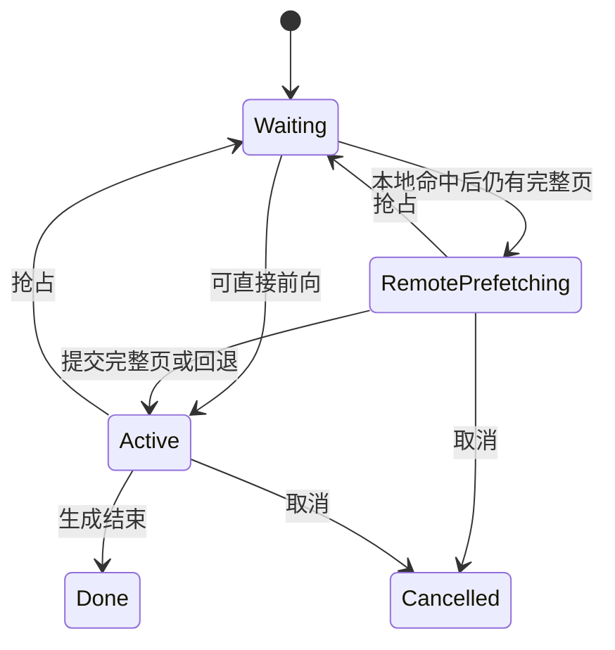

# Nano-VLLM 远程 KV 集成与验收

## 工作树与验证状态

基线为 `dev` 的 `b350cb0b1fd29475d53b00bf5fa8dfc7e22edb70`。工作树已有未提交的远程 KV 接入和 `third_party/NtyCo/core` 改动。本次在现有接入上完成修复、持续接收请求的 CLI 和实机验收，保留 NtyCo 的三处改动。

| 检查 | 本次结果 |
| --- | --- |
| C11 Debug，启用 io_uring | 14/14 通过 |
| C11 Debug，ASan、UBSan、泄漏检查 | 14/14 通过 |
| C11/CUDA Release，RTX 5060 Ti | 17/17 通过，包含真实 CPU 和 CUDA 多进程推理 |
| 关闭 `MINIINFER_WITH_KVFABRIC` | 7/7 通过，另执行了单机双请求 CLI |
| KVStore | 单测、分配器、已有客户端、Proactor、持久化、重连与两种 TCP 同步模式通过。另验证了 NtyCo 网络回归 |

## 调用链审计

| 模块 | 确认的职责和边界 |
| --- | --- |
| control/directory.c | 注册表、Manifest 副本、Lease 与版本围栏在目录互斥锁内操作，返回值副本 |
| control/wire.c、control/net.c、control/client.c | Wire V3 字段编码、TCP 截止时间、帧 CRC32C、返回 Manifest 和逐层数据校验 |
| worker/remote/worker.c、cache.c | Worker 持有命名空间、服务线程和导出引用。现有整序列入口从本地 Trie 匹配，再解析远程后缀 |
| worker/remote/transfer.c、peer.c、prefetch.c | TCP 逐层读取、连接池、远程 Lease 续期与验证、有限队列中的异步预取 |
| worker/allocator.c、storage_backend.c、tiered_storage.c | 内存池、驻留槽、READ/WRITE Lease 和提交版本 |
| worker/paged_kv.c、device_transfer.c、uring_io.c | 每页每层一个逻辑 Block。设备搬运使用 Stream/Event。io_uring 属于可选文件后端 |
| nanovllm/engine.c、cache.c、nano_cache.h | 请求进入等待位图，由单个驱动线程维护请求引用、本地前缀索引和 LRU。调度轮按 Token 预算推进前向 |
| nanovllm/cli.c、nano_cuda.cu、include/nanovllm/nv.h | CLI 装配模型、词表、设备和引擎。CUDA 前向沿同一 Stream 重放 Graph，再读取主机 logits |

## KV 布局与身份

Nano-VLLM 的 K 与 V 各占同一 FP32 缓冲区内一个连续区域，以分离的基址访问。CPU 与 CUDA 的两个区域都相邻，采用相同的元素索引。

```text
head_dim    = model_dim / n_heads
kv_dim      = n_kv_heads * head_dim
host_index  = (((physical_block * layers + layer) * tokens_per_page + token) * kv_dim)
head_index  = head * head_dim + coordinate
layer_half  = tokens_per_page * kv_dim * sizeof(float)
layer_bytes = 2 * layer_half
```

远程 Worker 的一个逻辑页包含若干独立存储 Block。每层 Block 的前半段为 K，后半段为 V，两段均按 Token、KV Head、Head Dim 排列。适配器导出时将 Nano 页的两侧分层配对，导入时用相同偏移写回两侧。检查点与页布局使用小端 FP32，单个元素 4 字节。

| 命名空间字段 | 来源 |
| --- | --- |
| Model | 已加载只读检查点映射的 SHA-256 |
| Tokenizer | BPE 算法版本、词表大小、最大词条长度及按 Token ID 排列的词条和分数的 SHA-256 |
| Layout | 布局版本、K/V 顺序和字节序、KV Head Count、Head Dim、Layer Count、Tokens Per Page、DType 和 CPU/CUDA 执行路径的 SHA-256。CPU 路径区分内建矩阵乘法与 OpenBLAS |
| Layer Count、Tokens Per Page、DType、Bytes Per Layer | 显式写入 kvf_namespace。适配器核对模型和池形状及 Wire V3 上限 |
| TP 和 PP | 两组的 Size 均为 1，Rank 均为 0。其他 Size 在初始化时拒绝 |
| Tenant | 租户字符串的 SHA-256 |

页哈希使用现有 KV-Fabric SHA-256 链。设本地已经持有前 k 个完整页，适配器从实际前缀获得 H(k−1)，再将这个父哈希及后缀的 Token 交给同一预取队列。队列用父哈希计算第一个待查页及后续候选页，每次返回的 Manifest 都要匹配当前页键和父哈希。首个缺失页终止续接。

## 状态机与生命周期



- **等待与 Prefill**。等待请求先匹配 Nano-VLLM 本地索引。待查后缀通过 `mi_remote_prefetch_async_after()` 进入 Worker 的有限预取队列，请求状态为 `NV_REMOTE_PREFETCHING`。调度轮从 `mi_remote_prefetch_poll()` 非阻塞收割票据，并继续驱动可运行请求。`NV_ACTIVE` 的 `computed` 小于 `prompt_len` 时执行 Prefill，随后执行 Decode。调用方用 `nv_engine_has_work()` 判断请求是否仍在途。
- **导入**。`mi_remote_import()` 校验 TCP 帧和 Manifest CRC32C，逐层提交私有 CPU 暂存页的 WRITE Lease。导入后验证目录租约仍有效，并确认释放成功。Nano-VLLM 预检空闲或可淘汰页，保留私有物理页并复制全部待提交的数据。CUDA 路径在模型 Stream 上完成 H2D 并等 Event。只有整批验证和复制通过后，驱动线程才提交物理页、更新前缀索引并推进 `computed`。
- **回退**。正常未命中可以使用缺口前已经连续验证的页。过期、CRC 失败、断连、取消、容量不足和复制失败会丢弃该次未提交的页，仍活跃的请求从本地命中处继续 Prefill。后台遇到异常时先归还已经暂存的页，再处理下一张票据。预取使用从入队开始的单调时钟截止时间，目录查询、连接、续租、拉取与最终校验都按剩余时间限制 RPC。超时或取消后的 Lease 释放由后台尝试，单次预算最多 100 毫秒。引擎关闭前等待票据并释放序列和暂存。
- **导出**。前向完成并填满提示词的物理页时，驱动线程取得独立快照。CUDA D2H 使用同一 Stream 并等待 Event。发布线程用逐层 WRITE Lease 写入远程 Worker 的 CPU 页，在全部层提交后封存，再通过 `mi_remote_publish_page()` 发布 Manifest。请求完成后，本地 LRU 和 Worker 导出引用继续持有各自的页。
- **淘汰**。本地淘汰先将对应导出放入失效队列，再复用物理页。发布线程关闭该导出的服务引用并请求 Directory Invalidate。Worker 出口容量达到上限时，正常压力淘汰还受活动 Lease 和后继页约束。Worker 退出时注销自身副本。
- **尾页**。不足一页的提示词 Token 继续正常前向。最后一个提示词 Token 的 logits 用于采样，因此预取上限为 floor((prompt_len−1)/page_size) 个页。恰好页对齐的提示词仍可发布最后一个完整页供其他请求使用。

发布队列互斥锁只保护所有权交接。Connector 的线程负责 TCP RPC。目录锁内运行元数据操作。导入预留空间依靠空闲页或内存 LRU，SSD 溢写沿正常 Prefill 路径运行。

远程存储为 CPU，GPU 页经主机缓冲区转换，Worker 之间使用 TCP。导出和在途发布快照分别受 `--kv-cache-capacity` 限制。远程 CPU 池另预留 `--blocks` 个页供一整个请求暂存，并为正在组装的发布保留一个页。多个重叠请求争用这部分空间时，未获得资源的请求按本地路径继续。

`--stdin` 使生产 `nanovllm` 和 `miniinfer` 在两次请求之间保持 Worker 注册。CLI 在调度循环外收集发布结果和指标，随后清理已完成的请求对象，保留本地索引和导出引用。请求 ID 在下次输入时可重用。

## 修改文件

| 文件 | 变化 |
| --- | --- |
| include/nanovllm/nv.h | 远程配置、可观测计数、请求状态和驱动 API |
| src/nanovllm/nano_remote_kv.h、nano_remote_kv.c | 身份、续链、物理页转换、后台导出、提交和取消 |
| src/nanovllm/engine.c、cache.c、nano_cache.h | 调度收割、请求抢占、物理页提交和淘汰回调 |
| src/nanovllm/nano_cuda.h、nano_cuda.cu | 可回退的完整页异步复制与 Event 完成检查 |
| src/nanovllm/cli.c | 参数校验、持续请求入口、驱动循环和指标输出 |
| include/miniinfer/remote_cache.h、paged_kv.h | 带父哈希的预取与发布、非阻塞票据收割和独立页封存 |
| src/worker/paged_kv.c | 检查各层已提交后封存独立页 |
| src/worker/remote/cache.c、prefetch.c、transfer.c、internal.h、worker.c | 后缀暂存、逐页导出与失效、总截止时间、请求和逐页传输计数 |
| src/nanovllm/CMakeLists.txt、src/integration/CMakeLists.txt | 接入可选 Connector，登记真实推理进程测试 |
| tests/nanovllm/remote_worker.c、test_remote_inference.py | 持久 Nano-VLLM 进程驱动、独立目录和故障代理、基准 |
| tools/kvf_bench.c | 适配进口函数的截止时间参数，保留原有逐 RPC 超时 |
| README.md、docs/nanovllm.md | CLI 入口与参数说明 |

## 复现验收

验收在 Ubuntu 22.04 WSL2 完成，使用 GCC 11.4、CMake 3.22.1、OpenSSL 3.0.2、liburing 2.0 和 Python 3.10。CUDA 使用 Toolkit 12.8.93、Windows 驱动 610.88 和 RTX 5060 Ti。下列 `120` 对应该 GPU 的编译目标。

```sh
cmake -S . -B build/nano-remote -G Ninja -DCMAKE_BUILD_TYPE=Debug -DMINIINFER_WITH_URING=ON
cmake --build build/nano-remote -j
OPENBLAS_NUM_THREADS=1 ctest --test-dir build/nano-remote --output-on-failure

cmake -S . -B build/nano-remote-asan -G Ninja -DCMAKE_BUILD_TYPE=Debug \
  -DKVF_SANITIZE=ON -DMINIINFER_WITH_URING=ON
cmake --build build/nano-remote-asan -j
OPENBLAS_NUM_THREADS=1 ASAN_OPTIONS=detect_leaks=1:halt_on_error=1 UBSAN_OPTIONS=halt_on_error=1 \
  ctest --test-dir build/nano-remote-asan --output-on-failure

cmake -S . -B build/nano-remote-release -G Ninja -DCMAKE_BUILD_TYPE=Release \
  -DNANO_WITH_CUDA=ON -DMINIINFER_WITH_CUDA=ON -DMINIINFER_WITH_URING=ON \
  -DCMAKE_CUDA_ARCHITECTURES=120
cmake --build build/nano-remote-release -j
OPENBLAS_NUM_THREADS=1 ctest --test-dir build/nano-remote-release --output-on-failure

cmake -S . -B build/nano-local -G Ninja -DCMAKE_BUILD_TYPE=Debug -DMINIINFER_WITH_KVFABRIC=OFF
cmake --build build/nano-local -j
ctest --test-dir build/nano-local --output-on-failure

make -j4 all test_unit test_allocator
python3 tests/kvstore/test_regressions.py
python3 tests/kvstore/test_reliability.py
python3 tests/kvstore/test_sync_e2e.py
make -j4 NTYCO=1 all
KVS_TEST_NETWORK=ntyco python3 tests/kvstore/test_reliability.py
```

| 验收用例 | 实际断言 |
| --- | --- |
| 两个 Worker 的共享前缀 | A 发布 5 个完整页。B 导入 5,120 字节，Prefill 从 32 减为 12 个 Token。B 的完整 K/V 页 SHA-256 与冷启动逐页一致，导入的 5 个页也与 A 一致。生成 Token 和生产 CLI 的文本输出均与冷启动一致 |
| 持续请求 | 生产 `nanovllm` 与 `miniinfer` 的发布进程在生成完成后继续在线，消费者首次走远程，第二次请求命中本地页 |
| 根页缺失时续接 | 目录中只保留后继页，本地持有完整前缀的 B 能续接。缺少根页或中间页的请求停在第一个缺口 |
| 兼容性与尾部 | 不同前缀、权重、词表、计算布局、页大小或租户不命中。短页保持零导出，页对齐提示词仍计算最后一个采样位置。CLI 验证 TP/PP 仅接受 1 |
| 故障 | 代理截断连接、修改 CRC 对应载荷、延迟数据触发超时或 Lease 过期。暂停调度收割时检查 Connector 仍按总截止时间停止拉取。还覆盖进程终止及同名重启、在途取消及后续请求 |
| 并发与淘汰 | 远程预取等待时，同一引擎中的短请求可以生成 Token。多请求竞争暂存池和物理页时，断言生成结果、回退次数与本地淘汰引发的失效 |

用本机的 `stories15M.bin` 另跑了 README 的生产 CLI 示例。CPU 和 CUDA 均导入 1 个完整页（55,296 字节），把消费请求的实际 Prefill 从 8 个 Token 减到 4 个，输出 `The quick brown fox jumpsed through the forest. He was so`，与同设备的无缓存输出逐字节相同。

在 `miniinfer --stdin --ssd-mode uring --ssd-slots 24 --blocks 9 --block-size 4` 上分别启用和禁用远程 KV，顺序运行短前缀、不同前缀和原短前缀。两组各成功读回 5 页、写出 11 页，生成 Token 均与关闭缓存的 CLI 一致。

CUDA 设备侧额外尝试了 Compute Sanitizer。当前 WSL 环境缺少 WDDM debugger interface，工具在初始化时退出。上表的 CUDA 结果来自实际 GPU 执行，ASan/UBSan 和泄漏检查覆盖 CPU 构建。

## 指标和 Loopback 基准

| 字段 | 计量点 |
| --- | --- |
| remote_lookup_requests、remote_lookup_hits | 实际 ACQUIRE_PREFIX RPC 次数及父哈希匹配的 Grant 次数 |
| remote_hit_pages、remote_hit_tokens、remote_import_bytes、remote_prefill_skipped_tokens | Nano-VLLM 本地索引提交成功后记账 |
| remote_prefetch_requests、remote_prefetch_failures、remote_prefetch_cancelled | 启动预取、预取故障或超时，以及引擎取消的请求数 |
| remote_prefill_fallbacks | 发起预取但没有提交远程页、继续本地 Prefill 的请求数 |
| remote_cache_evictions、remote_published_pages | Worker 导出引用被淘汰的累计数、当前可服务的本地导出数 |
| remote_transfer_latency_ns、remote_transfer_samples | 成功验证的逐页传输累计时间及页数。包括逐层 TCP、CRC 和必要的 Lease 续期，计时截止于 Connector 返回 |

### 环境与方法

2026-11-23 在同一台 Intel Core Ultra 7 265KF、NVIDIA RTX 5060 Ti 主机的 WSL2 上测量。KV-Fabric 使用 `127.0.0.1` TCP Loopback。CPU 路径使用 OpenBLAS 0.3.20 单线程。每个设备单独对照 Cold、Local 和 Remote，每种模式 30 个单请求样本，顺序逐轮轮换。每个消费进程使用同一 Release 构建、检查点、词表及采样参数。

| 输入与设置 | 值 |
| --- | --- |
| 检查点 | `stories15M.bin`，legacy FP32，6 层、6 个 KV Head、Head Dim 48 |
| 权重 SHA-256 | `cd590644d963867a2b6e5a1107f51fad663c41d79c149fbecbbb1f95fa81f49a` |
| 词表 SHA-256 | `50a52ef822ee9e83de5ce9d0be0a025a773d019437f58b5ff9dcafb063ece361` |
| 预热与请求 | 共同前缀为 `The quick brown fox ` 重复四次，预热后缀为 `walks away`，请求后缀为 `jumps high` |
| 调度与采样 | 单个在途请求，最多 4 个活跃序列，每轮预算 16，最多生成 8 个 Token，种子 1234，温度 0.7，top-p 0.95，忽略 EOS |
| 缓存 | 每页 4 Token、48 个 Nano 物理页、48 个远程导出页，预取总超时 2000 毫秒 |

Cold 禁用前缀索引，Local 在消费进程用预热提示词建立索引，Remote 由另一进程完成同样的预热。计时从消费进程开始编码请求算起，已排除模型加载和预热。Prefill 延迟包括等待可用前缀到最后一个提示词位置完成前向，TTFT 计至首次采样完成。Decode 吞吐用首 Token 之后生成的 7 个 Token 计算。分位数使用最近秩法，逐请求 P99 在 30 个样本下为最大值。

```sh
MODEL=/path/to/stories15M.bin
TOKENIZER=/path/to/tokenizer.bin
for device in cpu cuda; do
  python3 tests/nanovllm/test_remote_inference.py \
    --directory build/nano-remote-release/bin/kvfabricd \
    --worker build/nano-remote-release/bin/test_nano_remote_worker \
    --model "$MODEL" --tokenizer "$TOKENIZER" --device "$device" --samples 30 \
    --benchmark "docs/benchmarks/nanovllm-remote-kv-$device-raw.csv"
done
```

### 实测结果

| 设备 | 模式 | TTFT P50 / P95 / P99（ms） | Prefill P50 / P95 / P99（ms） | Decode P50 / P95 / P99（Token/s） | 实际 Prefill / 本地复用 / 远程复用（Token） |
| --- | --- | ---: | ---: | ---: | ---: |
| CPU | Cold | 137.70 / 150.92 / 151.51 | 133.37 / 146.41 / 147.12 | 105.00 / 113.85 / 122.82 | 24 / 0 / 0 |
| CPU | Local | 26.28 / 28.66 / 29.06 | 22.32 / 24.10 / 24.90 | 106.18 / 112.16 / 136.86 | 4 / 20 / 0 |
| CPU | Remote | 94.10 / 109.55 / 110.36 | 89.79 / 104.20 / 105.07 | 107.42 / 120.53 / 121.59 | 4 / 0 / 20 |
| CUDA | Cold | 15.56 / 16.41 / 16.64 | 11.37 / 12.08 / 12.10 | 213.55 / 258.48 / 273.80 | 24 / 0 / 0 |
| CUDA | Local | 6.72 / 7.58 / 7.81 | 2.58 / 2.99 / 3.71 | 211.65 / 267.16 / 334.96 | 4 / 20 / 0 |
| CUDA | Remote | 79.58 / 84.37 / 84.39 | 75.05 / 79.33 / 79.72 | 222.91 / 271.78 / 272.44 | 4 / 0 / 20 |

Remote 每次提交 5 个完整页，共 276,480 字节。所有模式生成相同的 8 个 Token ID。对这个模型和提示词，CPU 的 Remote 首 Token 比 Cold 快，CUDA 的 Remote 首 Token 则更慢。CUDA 组的逐页传输时间与 CPU 组接近，预取耗时高于 CUDA 省下的前向时间。

| 消费设备 | 独立页计时数 | 逐页传输 P50 / P95 / P99（ms） |
| --- | ---: | ---: |
| CPU | 150 | 11.77 / 15.59 / 16.84 |
| CUDA | 150 | 12.14 / 15.12 / 16.62 |

| 设备 | 模式 | 消费进程 CPU 时间 P50（ms） | 消费进程 RSS 峰值 P50（KiB） | 推理分配后设备占用增量 P50（MiB） |
| --- | --- | ---: | ---: | ---: |
| CPU | Cold | 220.89 | 69,924 |  |
| CPU | Local | 99.26 | 70,052 |  |
| CPU | Remote | 103.14 | 73,680 |  |
| CUDA | Cold | 49.87 | 185,544 | 66 |
| CUDA | Local | 40.91 | 185,508 | 66 |
| CUDA | Remote | 44.64 | 189,104 | 66 |

Remote 发布进程的 CPU 时间 P50 为 10 ms，目录进程为 190 ms，两个设备组均如此。其当前 RSS 的 P50 分别为 CPU 组的 74,004 / 10,464 KiB 和 CUDA 组的 189,548 / 10,484 KiB。发布者与目录进程的 CPU 时间来自 `/proc`，粒度为 10 ms，按所有线程累加。WSL 上每 PID 显存字段为空，66 MiB 来自 `cudaMemGetInfo()` 在 CUDA Runtime 初始化后、推理分配前后的设备全局差值。CUDA 发布进程预热的设备占用增量同为 66 MiB。

每个请求 CSV 有 90 条记录，带生成 Token ID、计量值和进程资源数据。每个传输 CSV 有 150 条记录，按请求样本编号关联页完成次序。已复核逐页记录数量、耗时求和、命中计数与各模式生成结果。测量范围为本机 TCP 和固定并发，容量回退使用有限缓存池触发。

| 设备 | 原始请求样本 | 原始逐页样本 |
| --- | --- | --- |
| CPU | [CPU 请求 CSV](benchmarks/nanovllm-remote-kv-cpu-raw.csv) | [CPU 传输 CSV](benchmarks/nanovllm-remote-kv-cpu-raw-transfers.csv) |
| CUDA | [CUDA 请求 CSV](benchmarks/nanovllm-remote-kv-cuda-raw.csv) | [CUDA 传输 CSV](benchmarks/nanovllm-remote-kv-cuda-raw-transfers.csv) |
