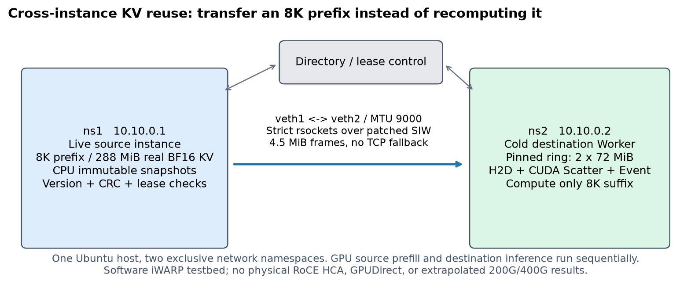
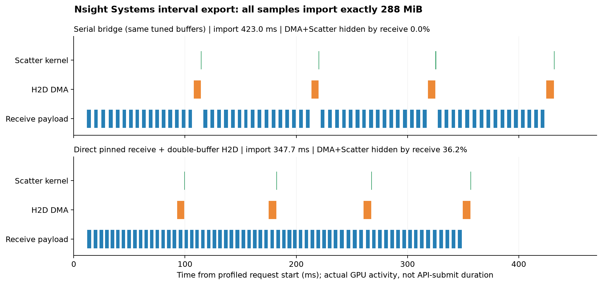

# 跨实例 RDMA「以传代算」审计与实测

2026-11-26，RTX 4060 Laptop 8 GiB，Ubuntu 6.8.0-149，Qwen2.5-3B-Instruct BF16。16,384 输入 Token、8,192 共享前缀、16 输出 Token，eager、batch-invariant、并发 1。请求 TTFT 从客户端发起到首个输出 Token，不含进程启动、模型载入和源端预热。这里的“冷”指目的实例没有目标 KV，权重和执行路径已预热。

**结论：跨实例拉取共享 KV 后只计算后缀，TTFT P50 从 5.568 s 降到 3.511 s（36.9%）。最终 15 个请求全部命中 8K，输出 Token ID 与原生重算逐个一致。** RDMA 在这里承担实际跨实例数据传输；收益来自省掉 8K Prefill，不能解释成 RDMA 比 TCP 更快。

## 测试床与硬件边界

`ns1=10.10.0.1/24` 与 `ns2=10.10.0.2/24` 通过 `veth1 ↔ veth2` 相连，MTU 9000，tx/rx checksum offload 关闭，RDMA 为 exclusive 模式。目录在 ns1，控制面走 19000 端口；KV 源实例的数据端口为 20001；目的服务使用显式非临时端口，避免 SIW 与控制连接争抢 ephemeral port。两端强制 `RDMA_RSOCKET`，不允许数据面静默退到 TCP。

当前内核的原生 RXE 和 SIW 均不能完成设备迁移：`rdma dev set … netns` 返回 `EOPNOTSUPP`；原生 RXE 的路由/UDP 接收仍使用 init_net。运行时切换 exclusive 又会因桌面程序已存在其他 netns 返回 `EBUSY`。脚本仅在 `ib_core` 引用为 0、无 RDMA 设备时重载空闲 core，不结束无关程序。

本轮采用明确标注的 **SIW 兜底**：从 Linux v6.8 官方源码构建临时模块，在 **设备注册前**将 `coredev.rdma_net` 设为 netdev 所属 netns。没有绕过活跃设备迁移检查，没有添加假的 disassociate 回调。源码 SHA256、构建器与模块哈希均保留。它是 **software iWARP**，不是 RXE Soft-RoCE，也不是物理 RoCE 网卡。加载模块会留下 kernel taint 诊断位，卸载后该位直到重启才清除；模块未安装进系统目录。

仅有一张 GPU，因此源侧先真实计算 8K 并导出 288 MiB BF16 KV，随后释放源推理进程。ns1 中另一个持续在线的源实例把该快照发布为有版本、CRC、租约保护的 CPU KV，ns2 推理时从它拉取。两边网络、进程、Worker 身份、KV 缓存均独立；源和目的推理没有同时占用 GPU，不是两机双 GPU 实验。



## 完整实测对账

原始请求和机器可读结果见 [summary.json](benchmarks/rdma-cross-instance-2026-11-26/summary.json)。延迟取 15 个无 profiler 请求的中位数；KV 就绪时间是 `load_total` 从执行加载到 GPU Event drain 完成，不含此前 scheduler lookup 和 executor 排队；P95 用 nearest rank，样本不足以声称生产 P99。Baseline 的失败样本保留在 TTFT 分布内；其导入吞吐只对成功传入完整 288 MiB 的 14 个请求定义。

| 场景 | TTFT P50 / P95 | 288 MiB KV 就绪 P50 | 有效 KV 就绪吞吐 | 占 288 MiB `ib_write_bw` 锚点 | 命中/失败 |
|---|---:|---:|---:|---:|---|
| 原生冷 KV 重算，16K 全算 | 5.567845 / 5.584322 s | — | — | — | 0 外部 Token |
| RDMA Baseline，默认缓冲＋临时 KV 中转＋同步 H2D | 3.765899 / 5.593181 s | 590.112521 ms | 0.476604 GiB/s | 34.614% | 14/15 命中；1 次安全回退 |
| 直接 pinned 接收＋调优缓冲，H2D 仍串行 | 3.546313 / 3.564749 s | 351.940169 ms | 0.799142 GiB/s | 58.039% | 15/15，0 失败 |
| **直接接收＋72 MiB 双缓冲流水线，最终代码** | **3.511360 / 3.528781 s** | **326.775471 ms** | **0.860683 GiB/s** | **62.509%** | **15/15，0 失败** |
| 本地 CPU 热回源，无网络参考 | 3.250286 / 3.258974 s | 67.896633 ms | 4.142326 GiB/s | 不适用 | 15/15，0 失败 |

最终版本相对冷重算 TTFT 下降 **36.935%**，相对 RDMA Baseline 下降 **6.759%**；KV 就绪时间下降 **44.625%**，吞吐提高 **80.587%**。CPU 热回源仍快 261.074347 ms，因此没有声称软件网络开销已经消失。

链路测试方向与业务一致：ns1 发、ns2 收，`ib_write_bw -R -t 8 -N`，相同设备、MTU、offload、用户权限，三轮结果如下。旧 perftest 标头虽写 MB/sec，其实现以 `0x100000` 除字节数，本表按 MiB/s 转换为 GiB/s；见 [perftest 官方实现](https://github.com/linux-rdma/perftest/blob/master/src/perftest_parameters.c)。它是本配置的实测 verbs 锚点，不能当作所有队列参数、所有消息大小下的绝对硬件极限。

| 消息大小 | 三轮平均吞吐（GiB/s） | 三轮中位数（GiB/s） |
|---|---|---:|
| 16 KiB | 1.904531 / 1.882725 / 1.781729 | 1.882725 |
| 4 MiB | 1.497988 / 1.554941 / 1.572168 | 1.554941 |
| 288 MiB | 1.376895 / 1.379746 / 1.374629 | **1.376895** |

`rstream` 三轮打印的 4 MiB 带宽为 8.01 / 6.93 / 7.33 Gb/s，288 MiB 为 8.06 / 8.08 / 7.93 Gb/s（中位数 8.06 Gb/s）。使用校验和显式消息长度，原始 stdout 位于 [ceiling/](benchmarks/rdma-cross-instance-2026-11-26/ceiling/)。它是往返传输，字节总量包含双向，不能直接当作单向 TTFT 或未经换算的 GiB/s。

**利用率要分两层：** 上表的 62.509% 用完整 KV 就绪时间作分母，包含元数据、源侧快照准备/CRC、网络、目的 CRC、Python 提交和 H2D。`nsys` 三个最终样本中，288 MiB 除以实际 payload receive 区间并集，再取中位数，为约 **1.335483 GiB/s，达到上述锚点的 96.992%**。这只能说明接收活跃时的数据流接近锚点，不能把 CRC/握手/间隙删掉后宣传软件栈总开销接近零。

## 代码瓶颈与改动

已有 Wire V3 `FETCH_BATCH` 已把 8 页聚合为一帧。本模型每个 16-Token 页为 36 层 × 16 KiB/层 = 576 KiB，所以每帧是 **4.5 MiB**，8K 前缀共 **512 页、64 个数据帧**。并非原实现逐层发 18,432 个网络 RPC；没有把已有批处理冒充新增优化。

实际瓶颈是接收后重复中转：`batch_recv → 临时 Trie/Storage 的逐层 WRITE lease → bridge copy_page → pinned → H2D → 每窗口同步`。新增 `mi_remote_snapshot_into` / `kvf_vllm_load_direct` 在调用者 pinned buffer 中接收，仍验证 frame CRC、每层 manifest CRC、parent chain、owner boot 和 FINISH lease；不创建目的临时 KV、不发布目的副本。失败窗口不可见，整体丢弃。另修复了空命中路径访问 `candidates[matched-1]` 的下溢。

CUDA 路径新增两槽 pinned/device staging ring。每槽 72 MiB，上一槽的 Event 完成前不得复用 Host、block ID 或 Device staging。网络接收下一槽时，上一槽异步 H2D + Scatter；最后统一 drain。任何网络、CRC、Event 失败都先停止早先 GPU 写入，再报告 scheduler 失效并回退。没有把网络与后缀 Prefill 重叠：Prefill 仍等待完整前缀可用。

传输参数只支持显式 opt-in，不盲目改默认值。请求 `SO_SNDBUF/SO_RCVBUF=1 MiB`，rdma-core 实际返回 **2 MiB**；SQ/RQ=384、inline=64。`RDMA_IOMAPSIZE` 保持 0，因为此路径用 `rsend/rrecv`，没有 `riowrite` 或 GPUDirect。复用连接和已经分配的发送 batch / pinned ring；仍存在控制 RPC、Python token/ID 对象和连接 miss 分配，不声称热路径完全零分配。

| 独立 288 MiB 直接接收微基准 | 首轮 P50 | 复测 P50 |
|---|---:|---:|
| 默认缓冲 | 483.093 ms | 486.436 ms |
| 请求 1 MiB，实际 2 MiB；SQ/RQ384 | 310.495 ms | 312.257 ms；反向复查 317.031 ms |
| 请求 4 MiB，实际 8 MiB；SQ/RQ384 | 329.754 ms | 334.967 ms |
| 实际 8 MiB；SQ/RQ1024 | 331.494 ms | 342.009 ms |

激进的实际 32 MiB、inline=0 配置在连接阶段失败，已排除且保留日志；默认配置最后一次重新创建监听失败为 `Address already in use`，也保留为失败，不计成吞吐。正式脚本使用非 ephemeral 的目的监听端口解决 SIW 端口空间争抢。

## nsys / NVTX 时间线与完全对账

最终代码三份 profiler 请求与 15 请求的延迟分布分开。NVTX 客户端 TTFT marker 与客户端计时器存在 0.016–0.021 ms 的边界差，本表使用 marker 时长，不把 instrumentation 差值隐藏在性能收益里。GPU copy 按 CUDA API correlation ID 关联，非 Host API 提交耗时。



最终 profiler 请求 index=2 的互斥时间分区如下，相加恰为 **3,536.673620 ms**；其客户端 TTFT 为 3,536.653297 ms。

| 互斥分区 | 时间（ms） |
|---|---:|
| 元数据查询、ACQUIRE、FINISH | 15.014481 |
| 响应等待与负载接收 | 281.590013 |
| frame / manifest CRC | 35.343724 |
| 未被上述阶段隐藏的 H2D + Scatter | 9.353588 |
| 8K 后缀 Prefill 的 GPU kernel active | 3153.186856 |
| 其余模型侧 GPU 工作（采样等） | 18.900093 |
| scheduler / Host 提交 / 其他间隙 | 23.284865 |
| **总计** | **3536.673620** |

四个 `execute_context(...2048...)` 的 CUDA correlation 确认目的侧只执行 8K 后缀。后缀 GPU 首 kernel 到末 kernel 的 span 为 **3164.529163 ms**，其中 active 如上；span 包含 GPU/Host dispatch 间隙，不能再与上表 Host 间隙相加。

重叠率的分母同样必须注明：`intersection(payload receive, H2D+Scatter active) / H2D+Scatter active`，三样本为 **40.786% / 35.944% / 36.169%**，中位数 **36.169%**；对串行基线均为 0。若用完整接收流水线（包括其 CRC/元数据）作重叠区间，中位数是 **71.250%**，这不是纯网络重叠率。按网络接收时间作分母的比例见 JSON。两种算法均没有用 CUDA API 的短提交范围冒充 DMA 重叠。

## 超时、断链、租约与未完成资源

`tc netem` 仅作用于 ns1 的 TCP 源端口 20001（SIW 数据连接），目录 19000 不受影响。高延迟为 100 ms，断链为 100% loss，两次加载预算都是 500 ms：

| 注入 | 加载失败返回 | 请求 TTFT（含全量回退重算） | 输出 / 请求返回后租约 |
|---|---:|---:|---|
| 数据延迟 100 ms | 500.667346 ms | 6034.037211 ms | Token 与原生一致；0 lease |
| 数据丢包 100% | 501.028338 ms | 6053.905384 ms | Token 与原生一致；0 lease |
| 移除 netem 后恢复 | 成功重新命中 8K | 3512.468356 ms | Token 一致，0 load error |

故障测试发现 `O_NONBLOCK` 不足以保证 provider 内部 deadline。修复前连接 acquire **135399.155523 ms**，即使应用请求早已到期。源码中 `rclose` 还会调用没有 deadline 的 graceful `rshutdown`；见 [rdma-core v39 源码](https://github.com/linux-rdma/rdma-core/blob/v39.0/librdmacm/rsocket.c)。

最终把建连交给最多 **16 个**有所有权的任务，调用线程用 monotonic timed condition 按剩余预算退出；超时任务只持有独立 socket，不持有 Worker、lease、KV 或调用者 staging。关闭使用有界 retire 队列，包含在最多 **512 个** socket 的总 admission 限制内；恢复前 provider 可能仍阻塞，不能声称每个 QP/FD 在 500 ms 内销毁。进程退出由 OS 回收最后的 FD/QP；运行期间按有界资源而非无限排队处理。共享桥接库使用 NODELETE 防止后台任务访问已卸载代码。

**零租约泄漏与零待关闭 socket 不是同一件事。** 控制面正常时已获得的票据通过 FINISH 释放；如果 ACQUIRE 已提交但回复丢失、客户端不知道票据，则只能靠目录 TTL 收敛。直接接收回归实测了这条 TTL 边界，没有把它改写为即时清零。

Baseline 中 1 次 I/O 错误与安全回退、18 MiB chunk 重叠不足、135 s 连接阻塞、激进参数失败、保守 Swap 阈值造成的启动中止，都保存在 `failure-history.json` 或原始本地归档。中止运行不进入本报告性能分布。期间一次并行运行 CTest 遇到 GPU OOM 与 TCP 故障测试预期变化；随后将新重连仅限定到 RDMA，并在推理进程结束后串行跑完 **24/24 CTest**。公开独立 CPU 检出为 **18/18 CTest**，Python 方法回归 **10/10**；不把中途失败覆盖为从未发生。

## 复现

需要 rsockets / libibverbs / perftest / iproute2 / ethtool / liburing / CUDA / vLLM 0.31.0。模型路径必须指向真实 Qwen2.5-3B-Instruct BF16；构建和测试不自动下载权重。`--python` 应指向装有 vLLM 的解释器，本机是 `/usr/bin/python3`。

```bash
cmake -S . -B build-rdma -DCMAKE_BUILD_TYPE=Release \
  -DMINIINFER_WITH_RDMA=ON -DMINIINFER_WITH_CUDA=ON \
  -DMINIINFER_WITH_URING=ON -DMINIINFER_BUILD_VLLM_BRIDGE=ON \
  -DMINIINFER_VLLM_CUDA=ON -DCMAKE_CUDA_ARCHITECTURES=89
cmake --build build-rdma -j2
ctest --test-dir build-rdma --output-on-failure
python3 -m pytest -q tests/vllm/test_audit.py
python3 tests/vllm/test_direct_snapshot.py build-rdma .kvfabric-local/rdma-snapshot-check
bash -n scripts/bench_rdma_cross_instance.sh
```

支持原生 RXE netns 的机器可直接运行；当前内核会明确失败，自动 trap 清理，不会伪装成功：

```bash
sudo bash scripts/bench_rdma_cross_instance.sh --provider rxe \
  --python /usr/bin/python3 --build "$PWD/build-rdma" --model "$MODEL" \
  --out "$PWD/.kvfabric-local/rdma-rxe" --rounds 15 \
  --buffer-bytes 1048576 --queue-size 384 --inline 64 --chunk-pages 128
```

完整 Before/After 的统一入口会构建隔离 Baseline、复测链路、生成源快照、运行三组 TTFT 与参数扫描，并自动汇总；MODEL 为权重路径：

```bash
bash scripts/reproduce_rdma_cross_instance.sh "$MODEL" "$PWD/build-rdma" \
  "$PWD/.kvfabric-local/rdma-reproduce" /usr/bin/python3
```

此入口组合了本轮逐阶段使用过的命令，已做语法检查；完整实验实际是下面的分阶段执行记录，没有声称刚刚又跑了一遍统一 wrapper。

本机已实测的 SIW 兜底（先构建、再由脚本临时载入；不覆盖系统模块）：

```bash
python3 scripts/build_siw_netns_testbed.py --out .kvfabric-local/siw-netns
sudo bash scripts/bench_rdma_cross_instance.sh --provider siw \
  --provider-module "$PWD/.kvfabric-local/siw-netns/siw.ko" \
  --python /usr/bin/python3 --build "$PWD/build-rdma" --model "$MODEL" \
  --out "$PWD/.kvfabric-local/rdma-full" --rounds 15 \
  --buffer-bytes 1048576 --queue-size 384 --inline 64 --chunk-pages 128
```

`--phase ceiling` 只测 verbs/rstream；`--phase tune` 对现有 `--snapshot-from` 做参数扫描；`--phase final` 用 `--reference` 与 `--snapshot-from` 回放最终优化、profiling、netem 与恢复。保存下来的真实 KV 只用于本地复测，不上传 GitHub。

需要重建原始串行桥接/连接基线时：

```bash
python3 scripts/build_rdma_baseline.py .kvfabric-local/rdma-before-src .kvfabric-local/rdma-before-build
```

原始 Baseline 请求采用 `worker --mode baseline`、默认缓冲与此 build；新路径为 `worker --mode optimized`、最终 build 和 1 MiB/384/64 参数。不要把全局调优参数同时塞给两组后仍称其为“默认缓冲 Before”。`summary` 记录的优化前/后数据来源见以下命令：

```bash
python3 scripts/summarize_rdma_cross_instance.py \
  --reference-dir .kvfabric-local/rdma-cross-instance/accepted-siw \
  --ablation-dir .kvfabric-local/rdma-cross-instance/final-rdma \
  --after-dir .kvfabric-local/rdma-cross-instance/verified-final-rdma \
  --ceiling-dir .kvfabric-local/rdma-cross-instance/ceiling-siw \
  --tuning-dir .kvfabric-local/rdma-cross-instance/tuning-confirm-siw \
  --out .kvfabric-local/rdma-cross-instance/report
python3 scripts/export_rdma_cross_instance.py .kvfabric-local/rdma-cross-instance \
  docs/benchmarks/rdma-cross-instance-2026-11-26
python3 scripts/render_rdma_cross_instance.py docs/benchmarks/rdma-cross-instance-2026-11-26
```

完整 `trace.nsys-rep` / SQLite 保存在本地各 `profile-*` 子目录；公开包只包含 request、metrics、提取的真实时间区间、perftest stdout 与原始文件 SHA256。`nsys profile --trace=cuda,nvtx,osrt --sample=none --cpuctxsw=none --capture-range=cudaProfilerApi --capture-range-end=stop --trace-fork-before-exec=true ... worker --profile` 与 `nsys export --type=sqlite ...` 由脚本自动执行。三张 PNG/SVG 的路径为 `docs/benchmarks/rdma-cross-instance-2026-11-26/figures/{architecture,nsys-rdma-h2d,ttft}.*`。

## 简历定稿（81 字符）

跨实例重算慢→聚合收发与边收边H2D→TTFT降36.9%，KV就绪吞吐达链路上限62.5%；双netns+SIW软件RDMA隔离，超时断链回退且Token一致。

不能把本机 SIW 标成 Soft-RoCE 或把这些数据当作物理 200G/400G RoCE 结果。物理 HCA 可能缩短传输，但此仓库没有这类实测，因而不承诺“十毫秒级”或直接贴近 CPU 热回源的幅度。
